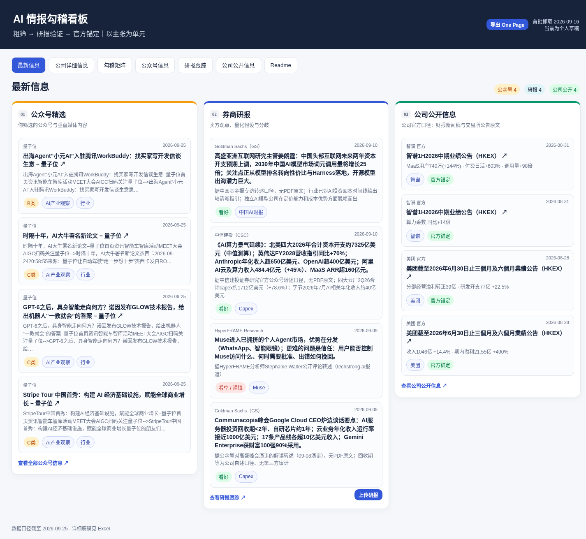

# AI 情报勾稽看板

一套三层信源的 AI 情报跟踪系统：公众号/垂直媒体粗筛 → 头部券商研报交叉验证 → 公司官方披露锚定。覆盖 Meta、Google、Amazon、Microsoft、OpenAI、Anthropic、腾讯、阿里、快手、美团、智谱、MiniMax 十二家公司的 AI 叙事、资本开支、广告与云商业化动态。

数据快照：2026-09-25（情报流水 162 条 + 公司官方口径库 68 条，Excel 底稿 10 张工作表同步）。

## 三层怎么勾稽

| 层 | 信源 | 作用 |
|---|---|---|
| ① 粗筛 | 虎嗅、量子位、Deeptech、腾讯科技、海豚投研等 12+ 源 | 主题初筛、数字锚点提取、A/B/C 分级 |
| ② 验证 | MS / GS / JPM 等头部券商 AI 研报 | 逻辑交叉核验，补全量化口径（转述并署名） |
| ③ 锚定 | SEC 8-K、港交所公告、公司官方新闻稿 | 原文中英对照摘录，作为事实底座 |

硬规则：冲突口径双方都保留、孤证不入事实底座、A 类必下钻 / B 类留要点 / C 类要点即止。

## 看板功能

- 首页三栏：最新公众号情报 / 券商研报跟踪 / 公司公开信息
- 情报流水：按来源分组，A/B/C 分级，主题 × 公司 × 日期联动筛选，每条含数字锚点、总结、下钻建议与原文直链
- 主题勾稽矩阵：同一主张在三层信源间的对照与冲突标注
- 公司页：单公司视图，卡片 + 官方事实 + OnePage 摘要草稿（可复制 Markdown / 导出 Word / 打印 PDF）
- 公司公开信息：公司 → 业务类别两级结构，官方原文中英对照 + 荧光标注
- Excel 底稿：与看板数据一一对应，爬虫增量同步



## 使用

看板是零依赖单文件，双击 `index.html` 即可打开，或部署到 GitHub Pages。

爬虫增量更新（可选）：需要 Python 3.10+ 与 `curl`，安装 `openpyxl` 后在仓库根目录运行：

```bash
python3 -m pip install openpyxl
python3 crawler/crawl.py
```

自动抓取虎嗅 / 量子位 / Deeptech 公开接口与搜狗微信索引通道，按关键词过滤、去重、自动分级后同步写入主页面、离线副本与 Excel 底稿。公众号通道受搜狗反爬限制；脚本不自带定时器，失败时可之后重新运行。需要 Cookie 时可设置 `LEDGER_SOGOU_COOKIE_JAR` 指向本机 Cookie 文件；Cookie 不得提交到仓库。

说明：静态看板可离线浏览；券商研报上传识别与 OnePage 详细稿生成需要单独部署 `backend/`，纯静态版本不启用这些按钮。私有研报 PDF 不随仓库分发，原有链接已替换为“私有库”标记。

## 目录结构

```
.
├── index.html
├── offline/AI情报勾稽看板_离线版.html
├── data/AI情报勾稽底稿.xlsx
├── crawler/crawl.py
├── backend/                  # 可选 FastAPI + PostgreSQL 服务
├── archive/early-react-prototype/ # 早期空数据React/Vite源码，已去内网配置
├── docs/                     # 首页截图与后端封面
├── PACKAGE_MANIFEST.md       # 完整文件清单与对账结果
├── LICENSE_NOTICE.md         # 未授予开源许可的说明
└── SHA256SUMS.txt            # 文件校验和
```

早期工程化原型也一并归档，目录中已注明它不是当前数据看板源码。详细文件用途、有意排除项与对账结果见 `PACKAGE_MANIFEST.md`。
## 免责声明

本仓库是个人信息整理工具：研报观点均为转述口径并标注来源机构；官方数据以公司 SEC / 港交所披露原文为准；全部内容不构成投资建议。

## 上传 GitHub

```bash
git init -b main
git add .
git commit -m "AI 情报勾稽看板"
git remote add origin git@github.com:YOUR_USERNAME/ai-intelligence-ledger.git
git push -u origin main
```

将 `YOUR_USERNAME` 替换为自己的 GitHub 用户名。仓库含 `index.html` 静态页，推送后在 Settings → Pages 选择 main 分支即可开启 GitHub Pages 在线访问。

## License

No open-source license is included. Do not assume reuse or redistribution rights. See `LICENSE_NOTICE.md`; the repository owner should add a license only after confirming rights to grant it.
